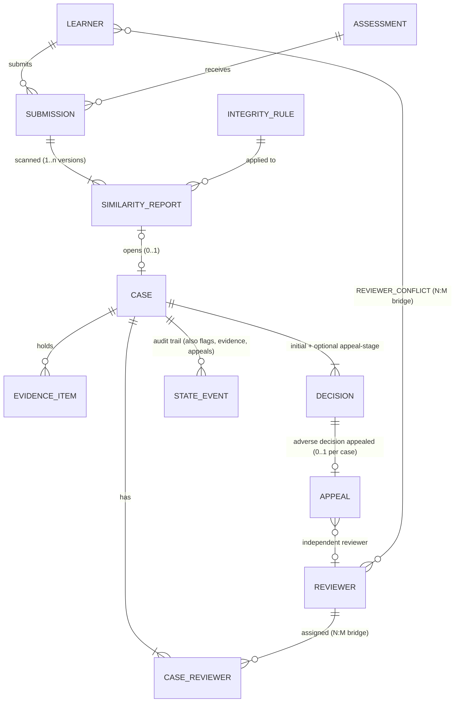

# Academic-integrity case management: synthetic dataset generator

Seeded, reproducible generator for the YottaFlex AI challenge _"Manage similarity flags, evidence, reviewer
assignment, case timelines and appeal outcomes with due process."_ It builds 10 related entities (plus 3
supporting tables), derives every outcome from documented rules, injects four **labelled** anomalies, validates
itself, and proves it is reproducible.

> Default run: **10,000 submissions, 1,000 flags, 300 cases**, seed `20261022`. Python 3 (tested on 3.12), **standard library only**.

## Quick start

```bash
python src/generate.py --seed 20261022 --scale 1.0 --out data   # full dataset (a few seconds)
python src/validate.py --data data                               # 117 checks, exit 0 = all good
python src/repro_check.py                                        # regenerate twice, compare checksums
python src/generate.py --scale 0.1 --out starter --no-docs       # starter set: 1,000 / 100 / 30, same generator
```

No install step, no network, no API keys. Outputs: `data/csv`, `data/json`, `data/sql/{schema,seed}.sql`
(SQLite-compatible), `data/ground_truth/` (separate), `data/manifest.json`, `data/checksums.sha256`;
docs in `docs/` (`data_dictionary.md`, `validation_summary.md/json`, `reproducibility_report.md`).

## How the data is built (and why)

| Step          | What happens                                                                                                                                                                                                                        |
| ------------- | ----------------------------------------------------------------------------------------------------------------------------------------------------------------------------------------------------------------------------------- |
| 1 Master data | reviewers (4 roles), learners, conflict-of-interest registry, assessments (30% use a shared template), `integrity_rules`                                                                                                            |
| 2 Submissions | unique learner x assessment pairs; timestamps cluster before the due date, 7% late                                                                                                                                                  |
| 3 Similarity  | every submission gets a report. 1,000 are chosen to be flagged (template assessments weighted 1.5x). Each flag gets a **latent cause**: `genuine`, `legit_quote`, `shared_template` or `false_positive`                             |
| 4 Cases       | opened by rule; reviewers assigned with conflict checks; evidence, votes, decisions, appeals, closure simulated as **time-ordered events**; anything after the snapshot (2026-10-31) is cut, so some cases are genuinely still open |
| 5 Anomalies   | injected **after** the clean baseline, only into targeted cases, each recorded in ground truth                                                                                                                                      |
| 6 Derivation  | counts, statuses, SLA flags, `integrity_status`, votes, evidence-at-decision are recomputed from source rows                                                                                                                        |
| 7 Export      | CSV / JSON / SQL / ground truth / dictionary / manifest / checksums                                                                                                                                                                 |

### Rules, not dice

- `integrity_rules` holds transparent bands on the **adjusted** score (raw minus detected quoted and shared-template text):
  `<0.25` no action, `0.25-0.50` standard review, `0.50-0.75` priority (2 reviewers), `>=0.75` panel (3). Lower bound inclusive.
  `auto_guilt_permitted` is `false` on every rule; a threshold only decides _how much human review_ happens.
- Reviewers vote independently, accuracy 90% when misconduct is real, 85% when overlap is benign (high scores bias
  reviewers). Majority decides; a 1-1 split between two reviewers adds a tiebreak reviewer. Severity (warning vs penalty)
  is a function of the adjusted score.
- Adverse decisions can be appealed within 14 days: P=0.80 if the learner was wrongly accused, 0.22 if guilty. An
  independent administrator (not on the case, no conflict) reaches the right conclusion 92% of the time. Overturning adds a
  **new** decision row that supersedes the old one; nothing is overwritten.
- Ground truth = the latent cause -> `expected_outcome`. Reviewer/appeal error rates are the only randomness between
  cause and outcome, which is why some wrongly-accused learners exist and some appeals succeed.
- The case count is pinned to the brief: all priority/escalation flags open a case (250) and 50 standard-review flags are
  referred by triage (300). That pin is a deliberate simplification; see Limitations.

### Entities and cardinality



Lifecycles: report `generated -> flagged -> triaged_closed | case_opened`; case `opened -> assigned -> under_review ->
decided -> closed | appealed -> appeal_under_review -> closed` (an appeal withdrawal goes `appealed -> closed`);
appeal `filed -> under_review -> resolved | withdrawn`. Rules carry `effective_from/to`; a superseded 2025 rule exists so
effective-dating is exercised. Full field-level spec: [`docs/data_dictionary.md`](docs/data_dictionary.md).

IDs: `SUB-2026-000001`, `SIM-<submission-id>-01`, `INT-2026-000001`, `EVD-<case-id>-001`, `APL-<case-id>-01`; supporting
IDs follow the same style (`CSE-2026-000001`, `DEC-<case-id>-01`, `CRV-000001`, `EVT-0000001`). All are zero-padded and immutable.

## Dashboard (optional visual demo)

```bash
python src/build_dashboard.py --data data     # writes dashboard/index.html (one file, ~0.7 MB, works offline)
```

Double-click `dashboard/index.html`. Three views: **Threshold lab** (slide the review threshold and see how many submissions
are flagged on raw similarity versus after quote/template exclusions), **Case explorer** (300 cases with timelines, reviewers,
evidence, decisions, appeals), **Audit findings** (the four detectors, with a button to reveal the ground-truth answer key and
compare). The page embeds the generated data; findings shown in the explorer come from the validator, not from ground truth.

## Labelled anomalies (`data/ground_truth/`)

| issue_type                                 | What is injected                                                                                                   | Detected by                                          |
| ------------------------------------------ | ------------------------------------------------------------------------------------------------------------------ | ---------------------------------------------------- |
| `flag_auto_guilt`                          | decision from score alone: no reviewers, 1 evidence item, `auto_threshold` basis, `opened -> decided` in 2 minutes | no decider, no reviewers, illegal lifecycle jump     |
| `reviewer_conflict`                        | a reviewer on the learner's conflict registry (or the assessing instructor) is assigned, `conflict_checked=false`  | join to `reviewer_conflicts` / assessment instructor |
| `evidence_added_after_decision_no_history` | evidence with `added_at` after the decision, stage not `appeal`, no `state_events` row                             | timestamp comparison + missing audit event           |
| `appeal_closed_without_independent_review` | appeal resolved with no reviewer, or reviewed by someone from the original case                                    | appeal reviewer null / on case / flag false          |

Counts: 8 / 8 / 8 / 6 at full scale (2.5% of cases, min 2). `ground_truth.csv` has one row per flag (latent class, band,
expected outcome, issue label). Generation never reads it; the validator reads it only after detection, to score the detectors.

## Validation results (full run)

- 112 structural checks pass (including audit-history completeness): PK/unique, FK (incl. polymorphic actor/entity refs), types, enums, ID patterns, date ordering,
  arithmetic, derived-field reconciliation, one-current-report, SQL seed loads into SQLite with a clean `foreign_key_check`.
- 5 process checks pass: each detector finds exactly its labelled cases (precision = recall = 1.0), and every illegal lifecycle
  transition belongs to a labelled anomaly.
- Negative tests: I corrupted a copy (broken FK, wrong `reviewer_count`, wrong `adjusted_score`) and the validator failed with exit 1.
- Reproducibility: two regenerations with the same seed produce identical normalized file checksums. The committed dataset matches the regenerated output after normalizing text-file line endings. A different seed produces different output.

Coverage highlights: 1,000 flags = 750 standard / 170 priority / 80 panel; 508 submissions with raw score >= 25% that were
**not** flagged because exclusions applied; boundary scores exactly at 0.25 / 0.50 / 0.75 and just under (0.2499); 429 false-positive
and 206 legitimate-quote flags; 245 of 300 cases with multiple reviewers (26 tiebreaks); 46 appeals, 9 successful (5 overturned,
4 reduced); 14 SLA breaches; 10 cases still in progress at the snapshot; 20 cases whose final outcome differs from the
ground-truth expectation: 11 real misconduct cases wrongly cleared, 4 penalties legitimately reduced on appeal, 3 planted
auto-guilt cases and 2 benign overlaps wrongly sanctioned.

## Assumptions and limitations (honest list)

- Fully synthetic; no external data, so no licensing exposure (`data/manifest.json` records this). Names are random picks from a built-in list.
- Latent causes and error rates are my modelling assumptions, not measured institutional statistics. Distributions are plausible, not calibrated.
- Case count is pinned to 300 by construction (referral set chosen first, latent class conditioned on it) rather than emerging from triage behaviour.
- Similarity "evidence" is metadata and hashes; there is no real text or document matching.
- Only one appeal per case and no second-tier appeal; no learner-side accommodations or collusion (multi-learner) cases.
- `top_source_type` and quote/template scores correlate with the latent cause, as real features would; they are signal, not labels.
- Event timestamps are plausible but not business-calendar aware (weekends/holidays ignored).
- The validator's detectors know the four anomaly _patterns_; they would not find a novel anomaly type.

## Layout

```
src/schema.py        data model: drives DDL, dictionary and validator
src/rules.py         thresholds, probabilities, rule lookup, rationale text
src/generate.py      generator + anomaly injection + exports
src/validate.py      structural checks, lifecycle, detectors, ground-truth scoring
src/repro_check.py   fixed-seed reproducibility proof
dashboard/           template.html + generated index.html (visual demo)
src/build_dashboard.py  embeds the dataset into the dashboard
docs/                dictionary, validation + reproducibility reports, AI_USE.md
prompts/PROMPT_LOG.md
```
