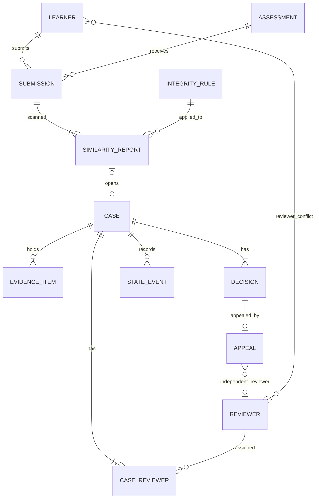
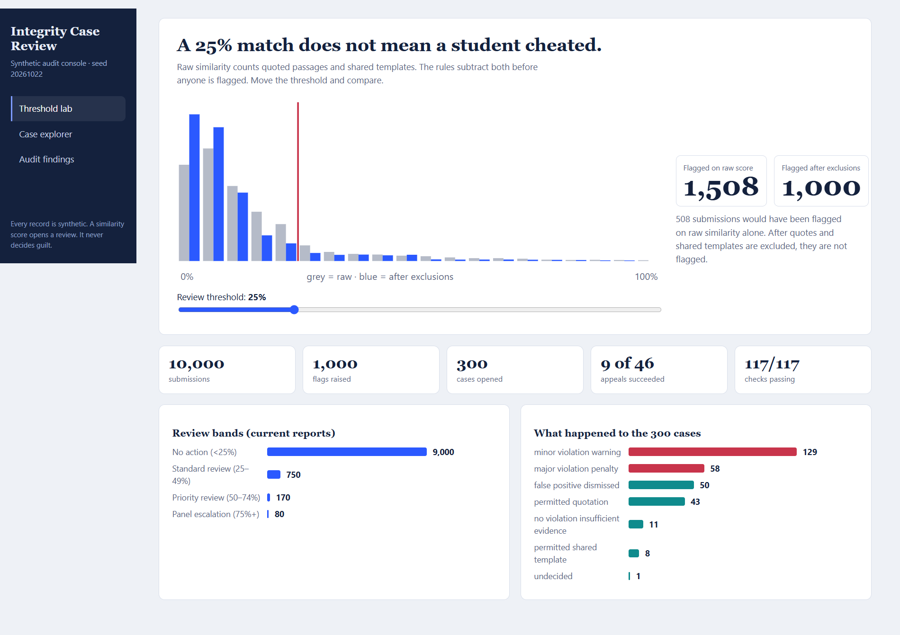
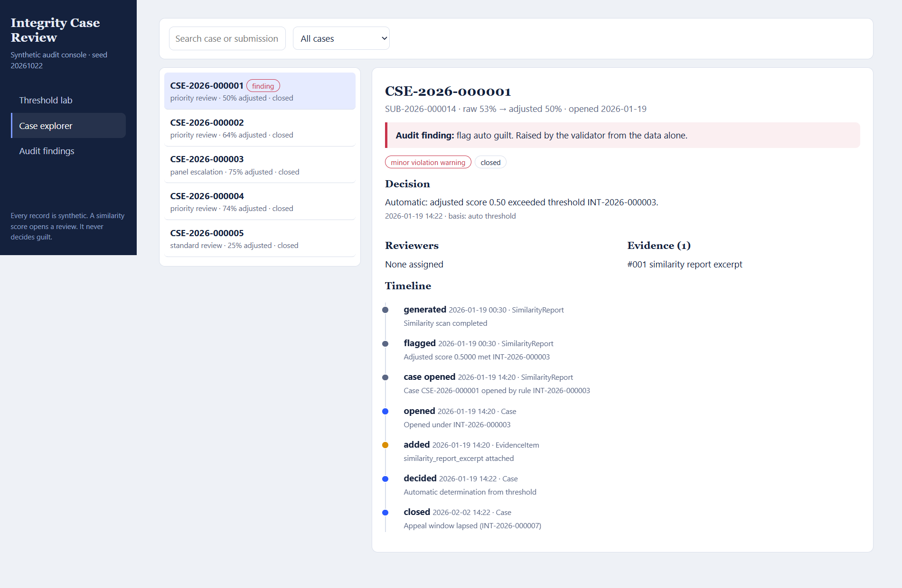
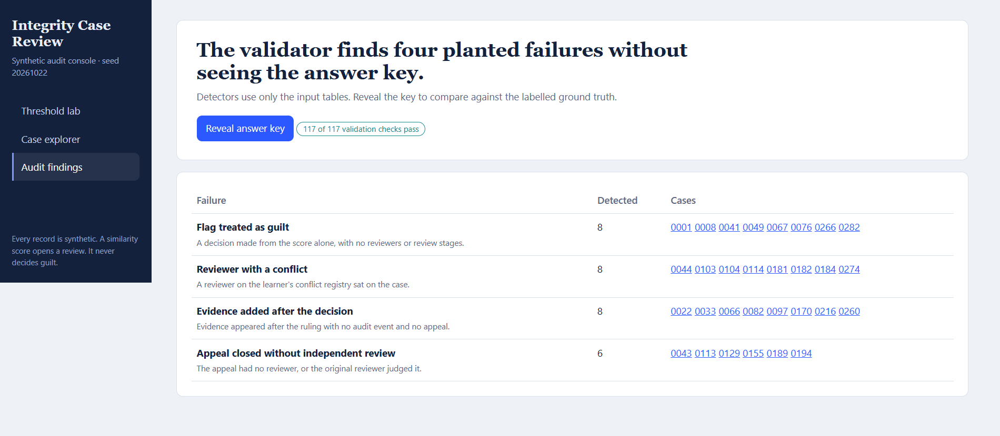

# Academic Integrity Case Management — Synthetic Dataset Generator

A deterministic, rule-driven synthetic data generator for an academic integrity case-management workflow.

Built for the YottaFlex AI challenge: **Manage similarity flags, evidence, reviewer assignment, case timelines and appeal outcomes with due process.**

The project models the workflow from submission and similarity reporting through human review, evidence collection, decisions, appeals and case closure. It generates relational datasets, injects labelled process anomalies, validates data integrity and checks reproducibility.

### Project at a glance

| Metric | Default output |
|---|---:|
| Submissions | 10,000 |
| Similarity flags | 1,000 |
| Integrity cases | 300 |
| Labelled anomaly categories | 4 |
| Structural validation checks | 112 |
| Process validation checks | 5 |

- **Language:** Python
- **Database:** SQLite-compatible SQL
- **Dependencies:** Python standard library only
- **Generation:** Seeded and reproducible
- **Dashboard:** Static HTML, works offline

---

## 1. Quick start

### Requirements

- Python 3.11 or later
- No external packages, API keys or network connection required

### Generate the dataset

```bash
python src/generate.py --seed 20261022 --scale 1.0 --out data
```

### Validate the generated data

```bash
python src/validate.py --data data
```

A successful run should report:

- 112/112 structural checks passed
- 5/5 process checks passed

### Verify reproducibility

```bash
python src/repro_check.py
```

This regenerates the data using the same seed and compares normalized output checksums. It also checks that a different seed produces different output.

### Generate a smaller starter dataset

```bash
python src/generate.py --scale 0.1 --out starter --no-docs
```

This generates a smaller dataset using the same generation logic.

---

## 2. System workflow

The generator follows a seven-stage pipeline:

| Stage | Description |
|---|---|
| 1. Master data | Generates learners, reviewers, assessments, conflict-of-interest records and integrity rules |
| 2. Submissions | Creates learner submissions with timestamps and assessment relationships |
| 3. Similarity reports | Generates similarity scores, applies exclusions and identifies flags |
| 4. Case management | Simulates triage, reviewer assignment, evidence, decisions, appeals and closure |
| 5. Anomaly injection | Introduces four deliberately labelled process anomalies |
| 6. Derivation | Recomputes statuses, counts, outcomes and other derived fields |
| 7. Export | Produces CSV, JSON, SQL, ground-truth data, documentation and checksums |

Workflow changes are represented through timestamped events so that the audit history is retained rather than relying only on the latest status.

---

## 3. Database design

The data model contains 10 primary business entities and 3 supporting tables.

The supporting tables include bridge relationships and event history.



The model uses:

- Primary and foreign keys to maintain relational integrity.
- Bridge tables for many-to-many relationships.
- Effective-dated integrity rules.
- Explicit lifecycle states.
- Append-only state events for auditability.
- Separate ground-truth records for anomaly evaluation.

Full field definitions and relationships are documented in [`docs/data_dictionary.md`](docs/data_dictionary.md).

---

## 4. Rule-driven decision workflow

The system uses documented rules rather than assigning outcomes independently at random.

### Similarity thresholds

Similarity scores are adjusted by excluding detected quoted and shared-template content.

| Adjusted score | Review level |
|---|---|
| Below 0.25 | No action |
| 0.25 to below 0.50 | Standard review |
| 0.50 to below 0.75 | Priority review — 2 reviewers |
| 0.75 and above | Panel review — 3 reviewers |

**A similarity threshold never establishes guilt automatically.** Every integrity rule has `auto_guilt_permitted = false`.

### Reviewer decisions

- Reviewers evaluate cases independently.
- The synthetic model uses assumed reviewer accuracy rates of 90% for genuine misconduct and 85% for benign overlap.
- Majority voting determines the outcome.
- A 1–1 split between two reviewers triggers a tiebreak reviewer.
- Decision severity is derived from the adjusted similarity score.

These probabilities are synthetic modelling assumptions, not measured institutional statistics.

### Appeals

- Adverse decisions can be appealed within 14 days.
- Appeals are evaluated by an independent administrator who was not involved in the original case and has no recorded conflict.
- Appeal outcomes follow the documented synthetic decision rules.
- An overturned or modified decision creates a new decision record; the original decision is retained.

---

## 5. Labelled process anomalies

Four anomaly categories are deliberately injected into the generated dataset.

| Anomaly | Description |
|---|---|
| `flag_auto_guilt` | A decision is made from a similarity score without the required human review |
| `reviewer_conflict` | A reviewer with a recorded conflict is assigned to a case |
| `evidence_added_after_decision_no_history` | Evidence is added after a decision without a corresponding audit event |
| `appeal_closed_without_independent_review` | An appeal is resolved without an eligible independent reviewer |

The validator checks for these patterns and compares the detected records against separately stored ground-truth labels.

At full scale, the generated dataset contains 8, 8, 8 and 6 labelled cases respectively.

**Ground truth is kept separate from the generated input records.** The generator does not use ground-truth labels to perform anomaly detection; the validator uses them to evaluate the detectors.

---

## 6. Dashboard

The project includes a static HTML dashboard for exploring the generated data and validation findings.

Generate it with:

```bash
python src/build_dashboard.py --data data
```

Open `dashboard/index.html` in a browser. The dashboard works offline and has three views:

1. **Threshold Lab:** Explore how review thresholds and quote/template exclusions affect flag counts.
2. **Case Explorer:** Inspect cases, timelines, reviewer assignments, evidence, decisions and appeals.
3. **Audit Findings:** Examine detected anomalies and compare them against the ground-truth answer key.

### Dashboard previews







The dashboard is a read-only inspection tool, not a live case-management application.

---

## 7. Validation and reproducibility

The full generated dataset is checked for structural integrity and workflow consistency.

### Validation coverage

- Primary-key and uniqueness constraints.
- Foreign-key relationships and referential integrity.
- Data types, enums and ID formats.
- Date ordering and lifecycle consistency.
- Derived-field reconciliation.
- Audit-history completeness.
- SQL schema and seed-data loading.
- Detection of the four labelled anomaly categories.

### Verification results

| Verification | Result |
|---|---|
| Structural validation | 112/112 passed |
| Process validation | 5/5 passed |
| Same-seed reproducibility | Passed |
| Committed dataset comparison | Matched after normalizing text-file line endings |
| Different-seed comparison | Produced different output |
| SQLite foreign-key integrity | No violations |

The validator's anomaly-detection results are measured against deliberately injected synthetic anomalies. They should not be interpreted as evidence of equivalent accuracy on real institutional data.

Detailed results are available in [`docs/validation_summary.md`](docs/validation_summary.md) and [`docs/reproducibility_report.md`](docs/reproducibility_report.md).

---

## 8. Assumptions and limitations

This project is a synthetic workflow and data-generation exercise, not a production plagiarism-detection platform.

- All generated records are synthetic; no real student records or external datasets are used.
- Reviewer and appeal accuracy rates are modelling assumptions and are not empirically calibrated.
- The case count is deliberately constrained to the challenge target of 300.
- Similarity evidence consists of metadata and hashes. The system does not perform actual document-level text matching or plagiarism detection.
- Only one appeal per case is modelled.
- The anomaly detectors target the four deliberately injected patterns; they do not establish general detection performance against unknown anomalies.
- The dashboard is static and read-only; it does not provide live case-management operations.
- Business-calendar effects such as weekends and holidays are not modelled.

---

## 9. Repository structure

```text
.
├── src/
│   ├── schema.py
│   ├── rules.py
│   ├── generate.py
│   ├── validate.py
│   ├── repro_check.py
│   └── build_dashboard.py
│
├── data/
│   ├── csv/
│   ├── json/
│   ├── sql/
│   ├── ground_truth/
│   ├── manifest.json
│   └── checksums.sha256
│
├── dashboard/
│   ├── template.html
│   └── index.html
│
├── docs/
│   ├── data_dictionary.md
│   ├── validation_summary.md
│   ├── validation_summary.json
│   ├── reproducibility_report.md
│   ├── AI_USE.md
│   └── img/
│
├── prompts/
│   └── PROMPT_LOG.md
│
└── README.md
```

---

## 10. AI-use disclosure

AI-assisted development was used during implementation. The AI-use disclosure documents which parts were generated with AI, the work performed to verify the implementation, engineering decisions, and known limitations.

- [AI use disclosure](docs/AI_USE.md)
- [Prompt history](prompts/PROMPT_LOG.md)

---

**Project:** Academic Integrity Case Management — Synthetic Dataset Generator  
**Challenge:** YottaFlex AI  
**Repository:** https://github.com/mikasa-tech/academic-integrity-case-generator


